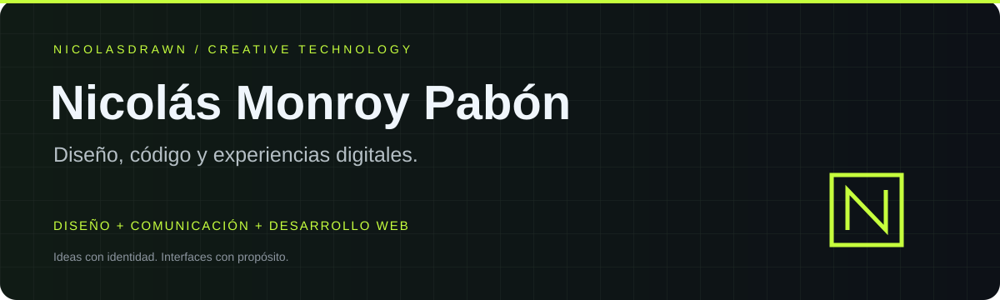

 

**Conecto identidad visual, estrategia e interfaces para crear experiencias digitales claras y útiles.**

## ◈ Sobre mí

Soy **Nicolás Monroy Pabón**. Mi trabajo combina diseño gráfico, UX/UI, comunicación y desarrollo web. Me interesa cómo se ve un producto, cómo se entiende y cómo se utiliza.

- **Diseño:** identidad visual, branding, interfaces y prototipado.
- **Desarrollo:** aplicaciones web y de escritorio, movimiento y experiencias interactivas.
- **Automatización:** herramientas internas, gestión documental e integración de procesos.
- **Comunicación:** narrativa de producto, contenido visual y marketing digital.
- **Exploración:** desarrollo Android con Kotlin y Jetpack Compose.

## ⌘ Tecnologías y herramientas

**Frontend**

**Diseño e interacción**

InDesign · GSAP · Framer Motion

**Backend y automatización**

**Entorno y aprendizaje**

## ↗ Proyectos destacados

<table>
<tr>
<td width="50%" valign="top">

### ◈ Brand OS
**Portafolio profesional**

Identidad personal, trayectoria y proyectos en una experiencia web que conecta trabajo creativo y técnico.

`Next.js 16` `React 19` `TypeScript`  
`Tailwind CSS` `Framer Motion`

[**Explorar portafolio ↗**](https://ncls.lat/)  
[Ver código](https://github.com/NICOLASDRAWN/NICOLAS-HYBRID-PORTFOLIO)

</td>
<td width="50%" valign="top">

### ◉ AURA
**The City's Soundtrack**

Landing page para un concepto de descubrimiento musical urbano. Narrativa de producto, identidad visual e interacción.

`JavaScript` `Vite` `GSAP`  
`Three.js` `HTML + CSS`

[**Explorar repositorio ↗**](https://github.com/NICOLASDRAWN/Aura-web)  
[Documentación y ejecución](https://github.com/NICOLASDRAWN/Aura-web#readme)

</td>
</tr>
</table>

## ◇ Software empresarial y automatización

Además de mis proyectos públicos, desarrollo herramientas internas que conectan procesos, interfaces y automatización.

| Área de trabajo | Contribución |
| :--- | :--- |
| Gestión de proveedores | Directorios, documentación e integraciones de análisis asistido por IA |
| Compras y suministros | Organización de registros y consulta de información operativa |
| Evaluaciones | Modelado de procesos, consolidación y revisión de resultados |
| Comunicación corporativa | Plantillas de correo y generación automatizada de PDF |
| Sincronización | Utilidades de escritorio e historial de respaldo de archivos |

**React · Express · Electron · Python · SQLite · Excel · APIs**

[**Leer los casos de estudio ↗**](./docs/case-studies/automatizacion-empresarial.md)

Casos redactados para presentación pública, con descripciones generales del trabajo y sin adjuntar código, registros ni configuraciones internas.

## ⌁ Laboratorio

| Proyecto | Qué encontrarás | Estado |
| :--- | :--- | :--- |
| [ConquistaLaCiudad](https://github.com/NICOLASDRAWN/ConquistaLaCiudad) | Base Android con Kotlin, Compose y Material 3 | Práctica inicial |
| [Prep-Course](https://github.com/NICOLASDRAWN/Prep-Course) | Material y ejercicios de programación | Formación |

## + Construyamos algo

¿Tienes una idea de marca, interfaz o producto digital? Escríbeme con una breve descripción del proyecto.

**[nicolasmonroypabon@gmail.com](mailto:nicolasmonroypabon@gmail.com)**

[Portafolio](https://ncls.lat/) · [LinkedIn](https://www.linkedin.com/in/nicolas-monroy-pabon-a8a838176/)

---

Nicolás Monroy Pabón · Diseño + Comunicación + Tecnología

